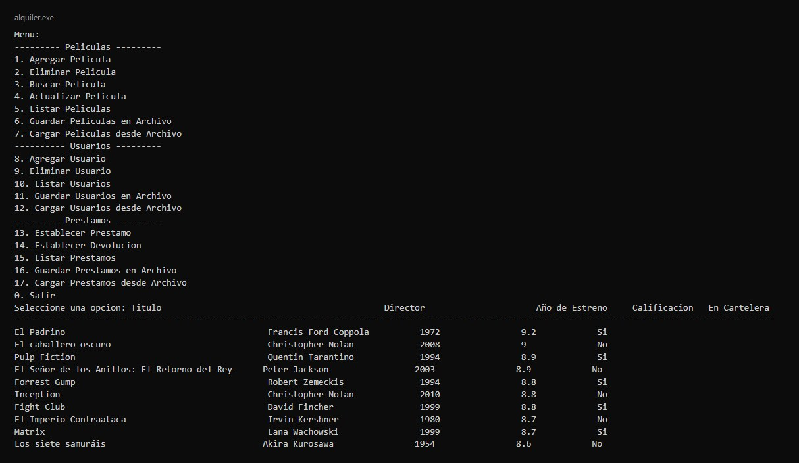
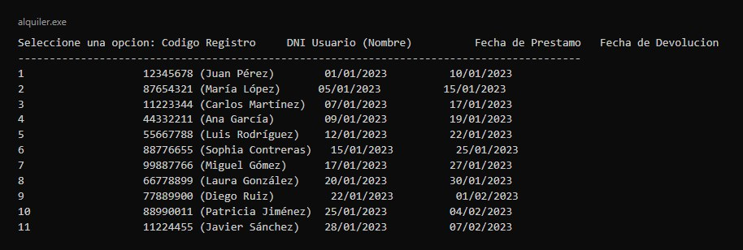

# Alquiler de películas en C++

Programa de consola para administrar un pequeño alquiler de películas: el catálogo, los usuarios y los préstamos. Fue el proyecto final de un curso de la UNSA en agosto de 2024.

Está dividido en tres módulos, cada uno con su `.h` y su `.cpp`:

- `peliculas`: título, director, año, calificación y si está en cartelera. Se pueden agregar, eliminar, buscar, actualizar y listar.
- `usuarios`: DNI, nombre, correo y teléfono.
- `prestamos`: código de registro, DNI del usuario y fechas de préstamo y devolución.

Cada módulo guarda y carga sus datos en un archivo de texto separado por comas. Los errores, como no encontrar una película o no poder abrir un archivo, se lanzan como `runtime_error` y el menú los atrapa sin cerrar el programa.

## En la consola

Menú principal y listado de películas después de cargar `peliculas.txt`:



Listado de préstamos con el nombre de cada usuario:



## Compilarlo

```
cd FINAL
g++ main.cpp peliculas.cpp usuarios.cpp prestamos.cpp -o alquiler
./alquiler
```

`peliculas.txt`, `usuarios.txt` y `prestamos.txt` traen datos de ejemplo. Para usarlos se elige la opción de cargar y se escribe el nombre del archivo.

© 2024 José Luis Cuenca Gutiérrez. Todos los derechos reservados.
